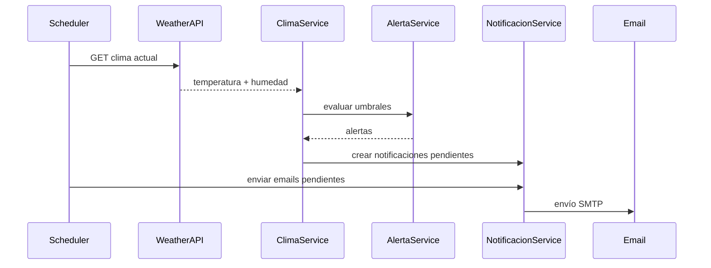

# ClimAlert

Servicio backend que consume una API climática, evalúa umbrales de riesgo configurables y programa notificaciones por email para las entidades suscriptas.

Hecho con **Java 21** y **Spring Boot**, con diseño por capas (controllers, services, repositories, clients) y tests unitarios para dominio y servicios.

## Stack

- Java 21
- Spring Boot 4 / Spring Web MVC
- Spring Mail
- Lombok
- Maven
- JUnit 5

## Cómo funciona



- Una tarea programada consulta el clima cada 5 minutos.
- Las alertas se evalúan contra umbrales configurables de temperatura y humedad.
- Las notificaciones pendientes se envían cada minuto mediante un `EmailServiceAdapter`.
- Los repositorios están detrás de interfaces, lo que permite reemplazar la implementación en memoria por una base de datos.

## Configuración

Copiá `src/main/resources/application.example.yaml` y pasá los valores por variables de entorno:

| Variable | Uso |
|---|---|
| `WEATHER_API_BASE_URL` | URL base de WeatherAPI |
| `WEATHER_API_KEY` | API key de WeatherAPI |
| `WEATHER_CITY` | Ciudad a monitorear |
| `MAIL_HOST` / `MAIL_PORT` | Servidor SMTP |
| `MAIL_USERNAME` / `MAIL_PASSWORD` | Credenciales SMTP |
| `CLIM_ALERT_TEMPERATURE` | Umbral de temperatura |
| `CLIM_ALERT_HUMIDITY` | Umbral de humedad |

No hay credenciales en el repositorio.

## Ejecutar

```bash
mvn spring-boot:run
```

## Tests

```bash
mvn test
```

## Estructura

```text
src/main/java/ar/edu/utn/frba/dds/climAlert
├── client/          # integración con WeatherAPI
├── config/          # configuración del cliente REST
├── controllers/     # endpoints de seed/demo
├── domain/          # Clima, Alerta, Entidad, Notificacion
├── dto/             # mapeo de respuestas de API
├── repositories/    # interfaces + implementaciones
├── schedulers/      # polling del clima + envío de notificaciones
└── services/        # lógica de negocio y adapter de email
```
