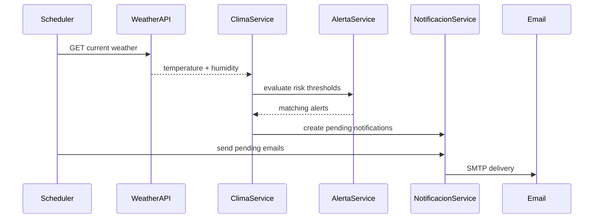

# ClimAlert

Backend service that consumes a weather API, evaluates configurable risk thresholds, and schedules email notifications for subscribed entities.

Built with **Java 21** and **Spring Boot**, with a layered design (controllers, services, repositories, clients) and unit tests for the domain and service layer.

## Stack

- Java 21
- Spring Boot 4 / Spring Web MVC
- Spring Mail
- Lombok
- Maven
- JUnit 5

## How it works



- A scheduled task fetches the current weather every 5 minutes.
- Alerts are evaluated against configurable temperature and humidity thresholds.
- Pending notifications are sent every minute through an `EmailServiceAdapter`.
- Repositories are abstracted behind interfaces, making it easy to swap the in-memory implementation for a database.

## Configuration

Copy `src/main/resources/application.example.yaml` and provide the values through environment variables:

| Variable | Purpose |
|---|---|
| `WEATHER_API_BASE_URL` | WeatherAPI base URL |
| `WEATHER_API_KEY` | WeatherAPI key |
| `WEATHER_CITY` | City to monitor |
| `MAIL_HOST` / `MAIL_PORT` | SMTP server |
| `MAIL_USERNAME` / `MAIL_PASSWORD` | SMTP credentials |
| `CLIM_ALERT_TEMPERATURE` | Temperature threshold |
| `CLIM_ALERT_HUMIDITY` | Humidity threshold |

No credentials are committed to the repository.

## Run

```bash
mvn spring-boot:run
```

## Test

```bash
mvn test
```

## Project structure

```
src/main/java/ar/edu/utn/frba/dds/climAlert
├── client/          # WeatherAPI integration
├── config/          # REST client configuration
├── controllers/     # Seed/demo endpoints
├── domain/          # Clima, Alerta, Entidad, Notificacion
├── dto/             # API response mapping
├── repositories/    # Repository interfaces + implementations
├── schedulers/      # Weather polling + notification dispatch
└── services/        # Business logic and email adapter
```
